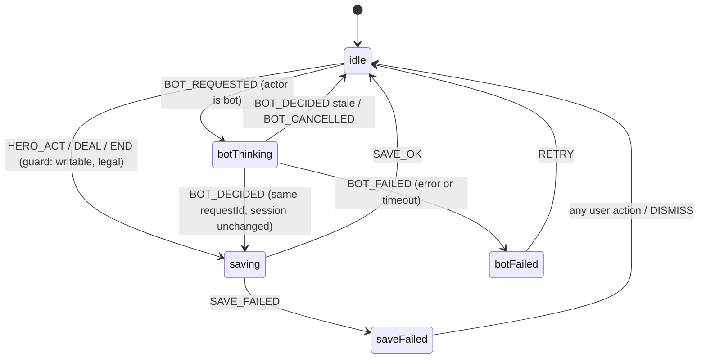

# Design Document: guest-mvp-release

## Overview

This release finishes the guest-only heads-up practice MVP that already exists as uncommitted work on top of `4ac8b7d`. The design adds no new product features. It fixes the stuck-busy defect, makes action recording independent of engine labels, removes deferred cloud code from the shipped graph, unifies chip formatting, enforces security headers locally and live, and adds the release machinery (artifact checks, header-aware preview server, live smoke script, deploy gating and status docs).

Main design decisions:

| Area | Decision | Rationale |
|---|---|---|
| Busy state | Replace ad-hoc `busy` boolean with a pure `playReducer` phase machine; `busy` is derived, never set directly | A stuck state becomes unrepresentable: every busy phase has a terminal event, and stale events are no-ops |
| Action recording | New adapter function `recordedAction(before, after, actor)` that counts the actor's turns across all betting rounds and canonicalizes by amounts, not engine labels | Robust to `autoAdvance` opening a new round and to engine `all-in.from` labeling |
| Deferred code | Delete `apps/web/src/cloud.ts` and the worker `equity` kind (Req 5.4 option A) | Simpler than a transitive-import check; `check:dist` still greps for `supabase` |
| Chip units | One `formatAmount` function plus a `ChipUnitProvider` context at the app root | Play and History read the same live value; changes apply without reload |
| Local headers | Tiny Node static server `tools/serve-dist.mjs` that parses `dist/_headers` | Deterministic, no new dependency, no Cloudflare login; the live smoke check covers real Cloudflare behaviour |
| Bundle size | Lazy-load the Play route (`React.lazy`) so `poker-engine-ts` leaves the entry chunk | Measured entry is 554 kB; the engine is the bulk |
| Versioning | `package.json` becomes `0.1.0-rc.1`; tag `v0.1.0-rc.1` | Satisfies both 13.8 (suffix before tag) and 13.5 (equal after tag) without a later edit |

Research notes that shape the design:

- Cloudflare Workers static assets apply `_headers` rules by request path; the SPA fallback (`not_found_handling: single-page-application`) serves `index.html` for unknown paths. Whether `_headers` rules for `/*` also attach to the fallback response is verified by the live smoke check (Req 12.5), not assumed. See [Cloudflare static assets headers](https://developers.cloudflare.com/workers/static-assets/headers/).
- `vite preview` ignores `_headers`, so the current Playwright setup cannot prove Req 8.6.
- React applies `style` props through the CSSOM, which `style-src 'self'` does not block; only inline `<style>`/`style=""` markup in HTML is blocked. Vite's production `index.html` contains only external module scripts and stylesheet links; `check:dist` asserts that no inline `<script>` or `<style>` exists.
- `new Worker(new URL('./bot.worker.ts', import.meta.url), { type: 'module' })` emits a same-origin hashed file, compatible with `worker-src 'self'`.

## Architecture

```mermaid
flowchart LR
  subgraph Browser
    UI[Pages: Home / Play* / History / Review / Settings / About]
    CU[ChipUnitProvider]
    SS[StoreStatusProvider]
    PC[useGame + playReducer]
    WC[workerClient]
    BW[bot.worker - standard-v1]
    AD[packages/poker adapter]
    ST[packages/persistence - Dexie]
  end
  UI --> CU
  UI --> SS
  UI --> PC
  PC --> AD
  PC -->|observe(state,'bot') only| WC --> BW
  PC --> ST
  CU --> ST
  SS --> ST
  subgraph Release
    CK[pnpm check: lint, typecheck, test, build, check:dist]
    SV[serve-dist.mjs applies dist/_headers]
    E2E[Playwright x3 browsers, retries 0]
    PK[pokerkit_rules.py]
    WR[wrangler deploy]
    SM[smoke-live.mjs]
  end
  CK --> SV --> E2E --> PK --> WR --> SM
```

`*` Play is a lazy chunk containing `poker-engine-ts`, `useGame`, `session.ts` and `workerClient`.

### Play controller flow



`busy = phase.kind === 'saving' || phase.kind === 'botThinking'`. Every busy phase has exactly one owner that must emit a terminal event from a `finally` block or effect cleanup.

## Components and Interfaces

### 1. Play controller (`apps/web/src/playMachine.ts`, new; `useGame.ts`, rewritten)

```ts
export type SaveOp = 'hero' | 'bot' | 'deal' | 'end';
export type Phase =
  | { kind: 'idle' }
  | { kind: 'saving'; op: SaveOp; token: number }
  | { kind: 'botThinking'; requestId: string; sessionRef: object }
  | { kind: 'botFailed'; message: string }
  | { kind: 'saveFailed'; message: string };

export type PlayEvent =
  | { type: 'SAVE_STARTED'; op: SaveOp; token: number }
  | { type: 'SAVE_OK'; token: number }
  | { type: 'SAVE_FAILED'; token: number; message: string }
  | { type: 'BOT_REQUESTED'; requestId: string; sessionRef: object }
  | { type: 'BOT_DECIDED'; requestId: string; stale: boolean; token: number }
  | { type: 'BOT_CANCELLED'; requestId: string }
  | { type: 'BOT_FAILED'; requestId: string; message: string }
  | { type: 'RETRY' } | { type: 'DISMISS' };

export function playReducer(phase: Phase, event: PlayEvent): Phase;
export const isBusy = (p: Phase): boolean => p.kind === 'saving' || p.kind === 'botThinking';
/** Pure enablement map used by Play; buttons and keyboard shortcuts both consult it. */
export function controlsFor(legal: LegalActionSet | null, busy: boolean):
  { fold: boolean; checkOrCall: boolean; raise: boolean; allIn: boolean };
```

Rules enforced by the reducer:

- Events carrying a `requestId` or `token` that does not match the current phase return the phase unchanged (stale events are no-ops, never re-enter busy).
- `SAVE_STARTED` is accepted only from `idle`, `botFailed` (hero cannot act there, so only `end`), `saveFailed`, or from `botThinking` via `BOT_DECIDED` (non-stale transitions straight to `saving` with the supplied token).
- `BOT_DECIDED` with `stale: true` and `BOT_CANCELLED` go to `idle` (Req 2.1, 2.2). No error is set.

`useGame` keeps a `phaseRef` updated synchronously alongside `useReducer` so a second click in the same tick sees `saving` and is dropped (Req 2.7, 10.4 rapid-click scenario). The bot effect:

```ts
useEffect(() => {
  if (!session || !writable || phase.kind !== 'idle' || frame(session.state).actor !== 'bot') return;
  const requestId = crypto.randomUUID(); const controller = new AbortController();
  dispatch({ type: 'BOT_REQUESTED', requestId, sessionRef: session });
  requestBot(observe(session.state, 'bot'), session.difficulty, controller.signal)
    .then(d => { const stale = controller.signal.aborted || active.current !== session;
                 if (stale) return dispatch({ type: 'BOT_DECIDED', requestId, stale: true, token: 0 });
                 runSave('bot', requestId, () => actAndSave(session, d.action)); })
    .catch(e => dispatch(controller.signal.aborted ? { type: 'BOT_CANCELLED', requestId }
                                                   : { type: 'BOT_FAILED', requestId, message: botMessage(e) }));
  return () => { controller.abort(); dispatch({ type: 'BOT_CANCELLED', requestId }); };
}, [session, writable, phase.kind]);
```

`runSave(op, requestId?, work)` allocates a token, dispatches `SAVE_STARTED` (or `BOT_DECIDED` non-stale), awaits `work()` and dispatches `SAVE_OK`/`SAVE_FAILED` in `finally`-guarded code. The lock-release path already awaits `operation.current`; that stays.

Bot timeout: `workerClient` keeps its 5 s timeout (under the 10 s limit in Req 2.4). The error banner shows "Retry bot" when `phase.kind === 'botFailed'`; `RETRY` moves to `idle`, which re-runs the effect once for the unchanged session (Req 2.5).

### 2. Poker adapter additions (`packages/poker/src/index.ts`)

```ts
/** Canonical action and chips added for the actor's single new turn between two states. */
export function recordedAction(before: EngineState, after: EngineState, actor: Actor): PublicAction; // throws RecordError
export class RecordError extends Error {}
export const BIG_BLIND = 100;
export const TOTAL_CHIPS = 20_000;
```

- `history()` canonicalizes by amounts: it tracks the round's running highest commitment (starting from the max of `openingContributions`, i.e. the big blind preflop). A contributing turn whose resulting street total exceeds the prior highest is `raiseTo(total)`; otherwise it is `call`. `fold`/`check` pass through with amount 0. This covers short all-in calls (Req 3.1) and all-in raises (3.2) regardless of the engine's `from` label.
- `recordedAction` filters `history(before)` and `history(after)` to the actor; it requires `after.length === before.length + 1` and returns the last entry, else throws `RecordError`. Because it filters by actor across all rounds, a new empty round opened by `autoAdvance` does not matter.
- `session.actAndSave` uses `recordedAction`; on `RecordError` it saves nothing and rethrows with "This action could not be recorded." (Req 3.9). The decision frame is still `frame(before)`, so a street-closing call carries the closing street (3.4).

### 3. Worker boundary

- `bot.worker.ts` accepts only `{ kind: 'decide' | 'cancel' }`; the `equity` branch and `estimateEquity` import are removed.
- `workerClient.requestBot` posts exactly `{ kind, id, observation, difficulty }` where `observation` is the output of `observe(state, 'bot')`. A unit test with a fake `Worker` global captures the payload (Req 4.5).

### 4. Chip formatting (`apps/web/src/format.ts`, `apps/web/src/chipUnit.tsx`)

```ts
export type ChipUnit = 'chips' | 'bb';
/** Whole chips as "1,250 chips"; bb as chips / BIG_BLIND to one decimal, "12.5 bb".
 *  signed: "+" if chips > 0, "−" (U+2212) if chips < 0, none if 0. Sign follows raw chips. */
export function formatAmount(chips: number, unit: ChipUnit, opts?: { signed?: boolean }): string;

export function ChipUnitProvider(props: { children: React.ReactNode }): JSX.Element;
export function useChipUnit(): { unit: ChipUnit; setUnit(u: ChipUnit): void; error: string | null };
```

The provider loads `getPreference(GUEST_OWNER)` once; on missing or failed load it uses `chips` and does not write (Req 7.3). `setUnit` updates context immediately and persists in the background (Req 7.6). Numbers use `toLocaleString('en-US')` for deterministic output. After "Delete local data" the provider resets to `chips`.

### 5. Store status (`packages/persistence`)

```ts
export async function openStore(): Promise<{ ok: true } | { ok: false; reason: string }>;
```

Called once at boot. Dexie runs upgrades inside a version-change transaction, so a failed upgrade aborts without partial writes. On failure, `StoreStatusProvider` shows "Saved hands could not be loaded. They have not been deleted." on Play, History and Settings and disables writes (Req 5.6).

### 6. Pages and routing (`apps/web/src/pages/*`, `components/*`)

- Extraction per Req 9.1–9.2: `pages/{Home,Play,History,Review,Settings,About,NotFound}.tsx`, `components/{Cards,Shell}.tsx`, `format.ts` holds `displayAction`.
- `main.tsx` keeps bootstrap and the route table; `Play` is `React.lazy(() => import('./pages/Play'))` inside `Suspense` with a "Loading table…" status. Must be verified: `@poker/analysis` (`potOdds`, used by Review) must not import `poker-engine-ts`; if it does, `potOdds` moves to a dependency-free module.
- Review rendering goes through a pure selector so hidden-card rules are testable without a browser:
  `reviewView(record: HandRecord, index: number, opts: { outcomeOpen: boolean }): { heroHole: [Card, Card]; board: Card[]; outcome: null | { finalBoard: Card[]; heroNet: number; botHole: [Card, Card] | null } }`.
- Play shows the opponent label "standard-v1 · experimental" (Req 5.9). History uses `formatAmount(h.heroNet, unit, { signed: true })`.
- Deferred paths (`/signin`, `/sync`, `/import`) fall through to `NotFound` (Req 5.3); no new routes are added.

If Req 9 is cut for schedule, the lazy Play route and `check:dist` size gate stay (they are small); only the file extraction is dropped.

### 7. Release tooling (`tools/`)

| Script | Command | Purpose |
|---|---|---|
| `serve-dist.mjs` | `node tools/serve-dist.mjs --port 4173` | Serves `dist/`, SPA fallback to `index.html`, applies every rule from `dist/_headers` (path glob + header lines), fixed MIME map (`.js` `text/javascript`, `.css` `text/css`, `.txt` `text/plain; charset=utf-8`, `.html`, `.json`, `.svg`, `.ico`, `.png`, `.woff2`). Defines no header values itself (Req 8.4) |
| `check-dist.mjs` | `pnpm check:dist` (appended to `run-check.mjs` after `build`) | Fails with a named reason if: entry chunk (from `index.html` `<script type="module" src>`) > 500,000 bytes (prints size; Req 9.5–9.7); any `.js` contains `supabase` (case-insensitive) or `cloud` module identifiers (5.1); any test hook marker (`__POKER_TEST`, `addInitScript`, files from `tests/`) appears (10.5); `index.html` has inline `<script>`/`<style>`; `dist/_headers` lacks or differs from the required CSP, `nosniff`, `no-referrer` values or has CSP tokens forbidden by 8.2 |
| `smoke-live.mjs` | `pnpm smoke:live --url <url> --commit <sha>` | Req 12; see Testing Strategy |
| `run-check.mjs` | `pnpm check` | lint, typecheck, test, build, check:dist |

`_headers` becomes:

```
/*
  Content-Security-Policy: default-src 'self'; script-src 'self'; style-src 'self'; worker-src 'self'; connect-src 'self'; img-src 'self'; font-src 'self'; object-src 'none'; base-uri 'self'; frame-ancestors 'none'; form-action 'self'
  X-Content-Type-Options: nosniff
  Referrer-Policy: no-referrer
  X-Frame-Options: DENY
  Permissions-Policy: camera=(), microphone=(), geolocation=()
```

`playwright.config.ts`: `webServer.command` switches to `serve-dist.mjs`; add `retries: 0` and `forbidOnly: true`. A shared fixture (`tests/e2e/fixtures.ts`) registers `securitypolicyviolation` and console listeners and fails the test on any violation (Req 8.6–8.7). The existing Worker/IDB overrides stay test-only via `page.addInitScript`; the CSP scenario and one full-hand scenario use the real worker.

### 8. Deploy workflow changes (`.github/workflows/deploy.yml`, `ci.yml`)

- `pnpm check` now includes `check:dist`; order stays check → e2e (3 browsers on the same `dist`) → PokerKit → `wrangler deploy`. `wrangler.jsonc` has no build command, so deploy uploads the tested `dist` unchanged (Req 10.3).
- New step after deploy: `pnpm smoke:live --url https://poker-practice.marton-kadi.workers.dev --commit ${{ github.sha }}` with Chromium only. A failed smoke leaves the deployment in place and the run red; the agent records the result.
- Add a first step that prints `github.sha` so the run log ties the run to the Candidate_Commit (Req 11.8).
- `ci.yml` runs the same `pnpm check` and the three-browser suite on pushes to the release branch, which provides the GitHub Actions fallback in Req 10.7.

### 9. Order of work

1. Preservation (Req 1): report the `safe.directory` error text and wait for Owner consent; branch `release/guest-mvp` from `4ac8b7d`; scan for `.env*` and credential files; run Vitest and Playwright Chromium on the untouched tree; commit everything with counts in the message; report SHA.
2. Access check: `gh auth status`, `gh secret list` (names only) for `CLOUDFLARE_API_TOKEN`/`CLOUDFLARE_ACCOUNT_ID`, and whether the `production` environment exists. Missing access becomes a Blocked_Gate immediately so the Owner can act in parallel.
3. Defects: play machine (Req 2), `recordedAction` + canonical history (Req 3), fixtures and PBTs.
4. Scope: delete `cloud.ts` and `equity` kind, opponent label, `openStore`, migration test (Req 4–5).
5. Formatter and chip-unit provider (Req 6–7).
6. Headers, `serve-dist`, `check-dist`, CSP fixture, e2e scenarios (Req 8, 10).
7. Lazy Play route; page extraction if time allows (Req 9).
8. Docs: `PLAN.md` statuses, README "Not in this MVP", roadmap status removal, version `0.1.0-rc.1`, screenshots (Req 13).
9. Candidate_Commit: clean-tree checks, PokerKit, record in `PLAN.md`; push; Owner dispatches deploy; smoke; prerelease; Delivery_Report (Req 10–14).

## Data Models

No schema changes. `HandRecord` stays `schemaVersion: 1`; Dexie stays at version 2; `ActiveSession`, `Bookmark` and `Preference` are unchanged. `Preference.animationSpeed` remains stored but has no UI.

Derived, non-persisted values:

- `Phase` (play machine, above).
- Big blind is the constant `BIG_BLIND = 100` for every MVP hand, so the History bb value is `heroNet / 100`. `HandRecord` does not store blinds; if blinds ever vary, a schema v2 must add them.
- Export_Archive: `{ format: 'poker-practice', schemaVersion: 1, exportedAt, hands: HandRecord[] }` (unchanged).

Replay inputs: `HandRecord` does not store the deck. The replay property (Req 3.6) is a test-level property: the generator keeps the deck it fed to `createHand` and replays the saved Canonical_Actions against `createHand(button, undefined, deck)`.

## Correctness Properties

*A property is a characteristic or behavior that should hold true across all valid executions of a system-essentially, a formal statement about what the system should do. Properties serve as the bridge between human-readable specifications and machine-verifiable correctness guarantees.*

Reflection on redundant criteria: 2.1, 2.2, 2.3 and 2.6 collapse into one liveness property over the reducer. 3.1–3.3 collapse into one canonicalization property. 4.1, 4.2 and 4.5 are one observation property (the worker payload is the observation). 4.3 and 4.7 are one review-view property. 6.1 is implied by the 6.2 round trip. 7.1, 7.2 and 7.4 are one formatter property. 5.8 is folded into the replay property's generator (every generated record is parsed by `handRecordSchema`).

Hand-level properties (3–7) share one generator: an injected RNG (`fc.integer` seed → deterministic PRNG) for the deck, a random button, and a random legal action policy for both seats (fold/check/call/min/random/max/all-in weighted), driven through `session.actAndSave`'s pure core until settled. Failures report the deck (as card text) and the action list via `fc` counterexample output.

### Property 1: Busy-state liveness

*For any* sequence of `PlayEvent`s applied to `playReducer` from `idle`, including stale, duplicated and out-of-order request ids and tokens, the phase is busy only while there is an outstanding bot request or save whose terminal event (`BOT_DECIDED`, `BOT_CANCELLED`, `BOT_FAILED`, `SAVE_OK`, `SAVE_FAILED` with the matching id or token) has not yet been applied; once every started request and save has received its terminal event, `isBusy` is false, and cancellation and stale decisions never produce an error phase.

**Validates: Requirements 2.1, 2.2, 2.3, 2.6**

### Property 2: Busy rejects input and controls follow legality

*For any* phase and any `LegalActionSet`, `controlsFor(legal, isBusy(phase))` enables no control when busy, and when not busy enables exactly the controls whose action is in the legal set (fold iff `fold`, check/call iff `check` or `call !== null`, raise iff `raise !== null`, all-in iff `allInTo !== null`); and a hero action submitted while busy leaves the phase and session unchanged.

**Validates: Requirements 2.7, 2.8**

### Property 3: Canonical action consistency

*For any* generated complete hand and every Decision_Record in it, `fold` and `check` have amount 0; a contributing action is `call` exactly when the actor's street total after the action does not exceed the street's highest commitment before it, and is `raiseTo(t)` otherwise with `t` equal to the actor's street total after the action; and in all cases the amount equals the decrease in the actor's stack caused by that action.

**Validates: Requirements 3.1, 3.2, 3.3**

### Property 4: Decision ordering by street

*For any* generated complete hand, the board length of consecutive Decision_Record frames is non-decreasing, every decision's frame street equals the street on which the action was taken, and each street-closing call appears before the first decision whose frame shows a card of the next street.

**Validates: Requirements 3.4**

### Property 5: Chip conservation

*For any* generated complete hand, every Decision_Record frame satisfies `stacks.hero + stacks.bot + pot = 20_000`, and the final hero and bot stacks sum to 20,000.

**Validates: Requirements 3.5**

### Property 6: Replay round trip

*For any* generated complete hand, the saved Hand_Record parses with `handRecordSchema`, and replaying its Canonical_Actions in order through the adapter from the same deck and button reproduces `finalBoard`, `heroNet`, `reachedShowdown` and `heroWonShowdown` exactly.

**Validates: Requirements 3.6, 5.8**

### Property 7: Hero contribution sum

*For any* generated complete hand, the sum of the hero's Decision_Record amounts plus the hero's posted blind (50 with the button, 100 without) equals the hero's total contribution, i.e. `10_000 − heroStackBeforeAward`, where the award is taken from the engine's settlement.

**Validates: Requirements 3.7**

### Property 8: Bot observation isolation

*For any* generated hand and every bot decision point on any street, the observation passed to `requestBot` (and therefore posted to the worker) has exactly the whitelisted keys of `PlayerObservation`, its `hole` equals the bot's hole cards, its `board` equals the cards dealt so far, and no card value anywhere in the serialized payload belongs to the hero's hole cards or to any undealt card.

**Validates: Requirements 4.1, 4.2, 4.5**

### Property 9: Review view shows only decision-time cards

*For any* Hand_Record and decision index, the pure selector `reviewView(record, index, { outcomeOpen: false })` returns the hero's two hole cards and exactly `frame.board` (length 0, 3, 4 or 5 by street), with no bot cards, later board cards or result; with `outcomeOpen: true` it adds the final board and `heroNet`, and adds bot cards only when `reachedShowdown` is true.

**Validates: Requirements 4.3, 4.7**

### Property 10: Export round trip

*For any* set of valid Hand_Records (including the empty set) stored for the guest, parsing `exportHands(GUEST_OWNER)` yields format `poker-practice`, schema version 1, and a hand list that validates with `handRecordSchema` and equals `listHands(GUEST_OWNER)` field for field.

**Validates: Requirements 6.1, 6.2**

### Property 11: Formatter consistency

*For any* integer `n` in [−20,000, 20,000], `formatAmount(n, 'chips', { signed: true })` is the sign prefix followed by `|n|` as an en-US whole number and ` chips`; `formatAmount(n, 'bb', { signed: true })` is the sign prefix followed by `(|n| / 100).toFixed(1)` and ` bb`; the sign prefix is `+` when `n > 0`, `−` when `n < 0`, and empty when `n = 0`, in both units.

**Validates: Requirements 7.1, 7.2, 7.4**

## Error Handling

| Failure | Detection | Behaviour |
|---|---|---|
| Stale or cancelled bot decision | `requestId` mismatch, `AbortSignal` | Reducer → `idle`, nothing saved, no message |
| Bot error or 5 s timeout | `requestBot` rejects | `botFailed`, session unchanged, "Bot decision failed." + Retry bot |
| Worker crash | `onerror` → `resetWorker` | Same as bot error; next request creates a fresh worker |
| Save failure (Dexie put/transaction) | `actAndSave`/`dealNext` rejects | `saveFailed`, `active.current` unchanged, "Your action was not saved. Try again." |
| Action not matched in history | `RecordError` | Nothing saved, "This action could not be recorded." |
| Restore of active session fails | `restoreState` throws | Existing behaviour: error + "Discard unfinished hand" |
| Store open/upgrade fails | `openStore` returns `ok: false` | Writes disabled; "Saved hands could not be loaded. They have not been deleted." |
| Preference load/save fails | provider catch | Chips unit, status message, stored value untouched |
| Export fails | `exportHands` rejects before blob creation | No download, "Export failed. Your saved data has not been changed." |
| Delete blocked or fails | lock unavailable / transaction rejects | Stay on Settings with the specific message; Dexie transaction rollback keeps data |
| Header/CSP/bundle violation | `check:dist`, e2e fixture | Non-zero exit naming header, URL or measured size; deploy step never reached |
| Cloudflare credentials missing/rejected | workflow step failure | Blocked_Gate in `PLAN.md` + report: step, error text, run URL, Owner action; deployment "not delivered" |
| Live smoke failure | `smoke-live.mjs` non-zero | Deployment stays; result recorded as failed; no prerelease |

Blocked_Gate entries in `PLAN.md` use one fixed shape:

```
- Gate: <name> — blocked (YYYY-MM-DD)
  Step: <workflow/job/step or local command>
  Error: <exact text>
  Run: <URL or "local">
  Commit: <sha>
  Owner action: <what is needed>
```

## Testing Strategy

### Unit and property tests (Vitest + fast-check)

- Library: `fast-check` 4.10.2 (already a devDependency). Each property is one `fc.assert` with `{ numRuns: 100 }` minimum; hand-level properties 3–7 use `numRuns: 200` (Req 3.8), property 8 at least 100 hands with bot decisions on all four streets ensured by a policy bias toward check/call.
- Each test carries a tag comment: `// Feature: guest-mvp-release, Property N: <title>`.
- Files: `apps/web/src/playMachine.test.ts` (P1, P2), `packages/poker/src/record.property.test.ts` (P3–P8), `apps/web/src/reviewView.test.ts` (P9), `packages/persistence/src/export.property.test.ts` (P10, fake-indexeddb), `apps/web/src/format.test.ts` (P11).
- Examples and edge cases:
  - Hook regressions with a fake `Worker` for Req 2.1, 2.2, 2.4, 2.6 (asserting busy clear and hero controls enabled afterwards, Req 2.9).
  - Fixed-deck rules fixtures for the seven cases in Req 3.10, asserting action and amount of every decision; the same fixtures feed `pokerkit_rules.py`.
  - `RecordError` path with a crafted state pair (Req 3.9).
  - Migration: build v1 and v2 databases with raw `Dexie` schemas under fake-indexeddb, seed a hand, a bookmark (v1: `record.bookmarked = true`) and an active session, close, open `PracticeDatabase`, compare counts and fields (Req 5.5, 5.7). A forced upgrade failure (throwing upgrade callback on a copy) checks 5.6.
  - Formatter: missing and failing preference → chips (7.3).

### Browser suite (Playwright, 3 browsers, `serve-dist`, retries 0)

| Req 10.4 scenario | Test notes |
|---|---|
| Showdown hand | Fixed deck via IDB-seeded active session; check/call to river |
| Fold hand | Hero folds preflop |
| Three hands, alternating button | Assert Dealer label alternates |
| Reload mid-hand | Compare board, stacks, action list before/after |
| 5 rapid clicks/keys | Assert exactly one new decision row and one Decision_Record in IDB |
| Worker failure + Retry bot | Fake Worker fails once, then real decision |
| Navigate away during bot turn | Delayed fake worker; return, controls enabled |
| Takeover after other tab advanced | Two pages in one context; close first, second loads latest |
| Unknown review id | "Hand unavailable" |
| Export | `page.waitForEvent('download')`, parse and validate |
| Deletion | Confirm dialog, IDB empty, home page |
| Keyboard-only hand | F/C/R + Tab/Enter only |
| 390 px viewport | Every route: `scrollWidth <= 390` |

Additional browser tests: header assertions on HTML routes, a JS chunk, the worker script, a CSS file, `/license.txt` and an unknown path (Req 8.1–8.5); a real-worker full hand + review + export + license with the CSP violation fixture active (8.6); deferred paths render not-found and pages contain no forbidden controls or terms (5.2, 5.3, 5.10); chip-unit toggle updates Play and History and survives reload (7.5, 7.6); opponent label on Play and About (5.9).

### Artifact checks

`pnpm check` → lint, typecheck, test, build, `check:dist`. Release_Checks = `pnpm check` + `pnpm test:e2e:release` + `python tools/reference/pokerkit_rules.py`, all on the same `dist` with no rebuild.

### Live smoke (`tools/smoke-live.mjs`)

1. `fetch` each of the seven paths with a 10 s timeout; assert 200, `text/html`, entry `<script type="module">`, CSP and the two headers.
2. Launch Chromium with a fresh context; record every request origin and every response's headers; fail on any foreign origin (12.3) or missing header (12.5).
3. Poll `/about` for up to 90 s until the build commit matches the `--commit` prefix (≥ 7 chars), allowing Cloudflare propagation; then fail on mismatch.
4. Deal and play check/call until "Next hand" appears (≤ 120 s), open the review, read the outcome, open History and compare the first row's result.
5. Print a pass/fail line per step with URL, expected and observed; exit 0 only if all pass.

### Open points for the Owner

- Evidence commits vs Req 10.9: recording check results in `PLAN.md` and replacing screenshots (13.6) change files after the Candidate_Commit passes. Proposed rule: commits that touch only `PLAN.md`, `docs/screenshots/*` or the Delivery_Report are evidence commits, are never deployed or tagged, and are allowed after the Candidate_Commit; screenshots are captured from the Candidate_Commit's `dist` before the evidence commit. This needs Owner agreement, or Req 10.9 should be clarified in requirements.
- Whether Cloudflare attaches `_headers` rules to the SPA fallback response is confirmed only by the first live smoke run. If it does not, the fallback would need a Worker script, which changes the $0 static-only posture and needs a requirements decision.
