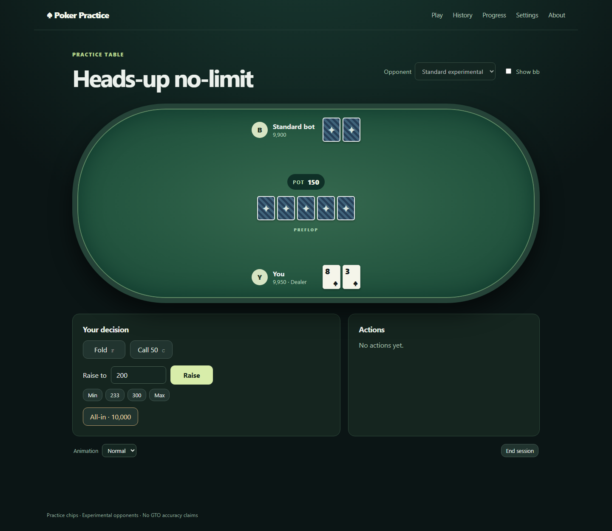
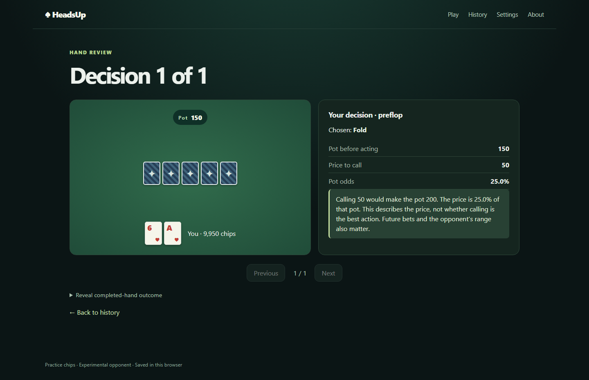

# Poker Practice

A desktop-focused heads-up no-limit Texas Hold’em practice site. Play 100bb hands against Easy or Standard **experimental** bots, then review decisions with pot odds and sampled equity against uniform legal opponent hands. These heuristics are not GTO-optimal and the review does not calculate EV loss. Practice chips have no cash value.

**Current status (2026-09-29):** guest gameplay, local recovery/history/review/progress, import/export, and the static build pass local checks. Google OAuth, cloud sync, database security, and account deletion are implemented but have not been verified against a running Supabase project. The owner created the [private GitHub repository](https://github.com/martonkadi/poker-practice); CI and production deployment remain unverified. See [PLAN.md](PLAN.md) and [acceptance evidence](docs/acceptance.md) for exact gates.





## Guest quickstart

Install Node.js **24.20.0** and Corepack, then from the repository root:

```text
corepack enable
pnpm install --frozen-lockfile
pnpm dev
```

Open the Vite URL shown in the terminal (normally `http://localhost:5173`). Guest play needs no `.env` file, Google account, or backend. Choose **Start playing**, then **Deal the first hand**. The bot runs in a browser Web Worker. Completed hands and an interrupted hand are saved in IndexedDB on this device.

## Local backend setup

Docker is required for the local Supabase stack. After the guest quickstart:

```text
pnpm exec supabase start
pnpm exec supabase db reset
pnpm test:db
pnpm exec supabase status -o env
```

Copy `.env.example` to `.env.local`. Set `VITE_SUPABASE_URL` to the local `API_URL` and `VITE_SUPABASE_PUBLISHABLE_KEY` to the local `ANON_KEY` from `supabase status`. These are browser-visible public values, not service-role credentials. Restart `pnpm dev` after editing `.env.local`.

Google OAuth is disabled in the tracked local `supabase/config.toml` so the database tests can run without Google. To test real local sign-in, configure a Google Cloud Web OAuth client with origin `http://localhost:5173` and callback `http://127.0.0.1:54321/auth/v1/callback`. Set `SUPABASE_AUTH_EXTERNAL_GOOGLE_CLIENT_ID` and `SUPABASE_AUTH_EXTERNAL_GOOGLE_CLIENT_SECRET` in an ignored `.env`, then set `[auth.external.google]` to `enabled = true`, `client_id = "env(SUPABASE_AUTH_EXTERNAL_GOOGLE_CLIENT_ID)"`, and `secret = "env(SUPABASE_AUTH_EXTERNAL_GOOGLE_CLIENT_SECRET)"`. Restart the local stack. See [Google’s Supabase setup guide](https://supabase.com/docs/guides/auth/social-login/auth-google). Do not commit either secret.

## Configuration

| Variable | Where | Purpose |
| --- | --- | --- |
| `VITE_SUPABASE_URL` | `.env.local` or GitHub environment variable | Public Auth/API endpoint; omit for guest-only mode |
| `VITE_SUPABASE_PUBLISHABLE_KEY` | `.env.local` or GitHub environment variable | Public project key; omit for guest-only mode |
| `VITE_APP_ENV` | `.env.local` or deployment | Build environment label |
| `CLOUDFLARE_API_TOKEN`, `CLOUDFLARE_ACCOUNT_ID` | GitHub production secrets | Static deployment |
| `SUPABASE_ACCESS_TOKEN`, `SUPABASE_PROJECT_REF`, `SUPABASE_DB_PASSWORD` | GitHub production secrets | Migration and Edge Function deployment |

Google’s client secret goes only into Supabase’s provider settings. The service-role key is used by the account-deletion Edge Function at runtime and must never have a `VITE_` prefix or enter the browser build.

## Commands

| Command | Result |
| --- | --- |
| `pnpm dev` | Vite development server |
| `pnpm build` | Production build in `dist/` |
| `pnpm preview` | Preview the production build |
| `pnpm lint` | ESLint |
| `pnpm typecheck` | Strict TypeScript check |
| `pnpm test` | Unit and integration tests, including 100 automated hands |
| `pnpm test:rules` | Engine adapter regression fixtures |
| `pnpm test:e2e` | Chromium guest browser tests; run `pnpm exec playwright install chromium` once |
| `pnpm test:e2e:release` | Sequential Chromium, Firefox and WebKit browser suite; install all three Playwright browsers first |
| `pnpm test:db` | Local Supabase authorization/sync tests after `supabase start` and `db reset` |
| `pnpm benchmark` | 10,000 paired deals per opponent with full policy sampling; long-running |
| `pnpm benchmark:browser` | 30 preflop Web Worker round trips per policy in local Chromium; reports machine and p95 latency |
| `pnpm check` | Lint, typecheck, unit/integration tests, build |

For a quick harness smoke test, run `pnpm benchmark --deals 5 --samples-standard 16 --samples-easy 16`. Its output is **not** strength evidence. The full benchmark must run separately before ordered difficulty claims are published.

## Data and privacy

Guest hands live only in IndexedDB. Signed-in hands are saved locally first and queued for transactional cloud synchronization after completion, on reconnect, and from History/Settings. One device produces each session; another can view retained history and start a new session. Two tabs cannot write the same local session simultaneously. Sign-out switches to an account-scoped local namespace. On first sign-in, Settings offers an explicit choice to import guest hands.

Settings exports versioned JSON, validates and deduplicates imports, deletes this device’s data, and offers account deletion. The cloud retains the latest 500 hands or 2 MiB of hand JSON per user, whichever is lower; older cloud bookmarks vanish when their hand is pruned. Cloud aggregate counters survive detail pruning. Local history is not pruned by cloud retention. The initial cloud enrollment cap is 100 accounts. If the cloud is offline or unavailable, play continues locally and an unavailable-sync message appears.

The bot receives only its hole cards and public state. The review equity sampler uses only the player’s cards and board visible at that decision. See [architecture](docs/architecture.md), [bot policy](docs/bot-policy.md), and [operations](docs/operations.md).

## Deployment and contributing

The [deployment runbook](docs/deployment.md) covers Supabase, Google, Cloudflare, GitHub secrets, and rollback. The GitHub repository is intended to remain private; deploying a `workers.dev` site makes the website public. Read [PLAN.md](PLAN.md), [AGENTS.md](AGENTS.md), and the [roadmap](docs/roadmap.md) before changing implementation.

First-party code is [MIT licensed](LICENSE). [Third-party notices](THIRD_PARTY_NOTICES.md) include the patched rules engine and PokerKit reference.
